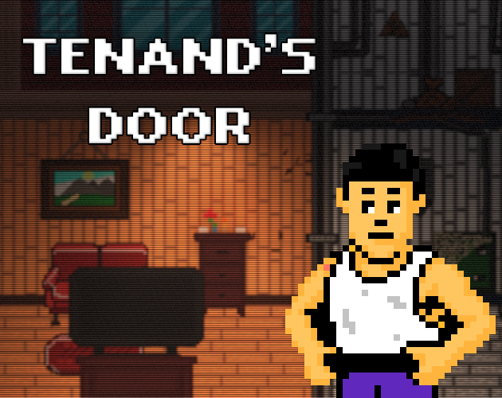
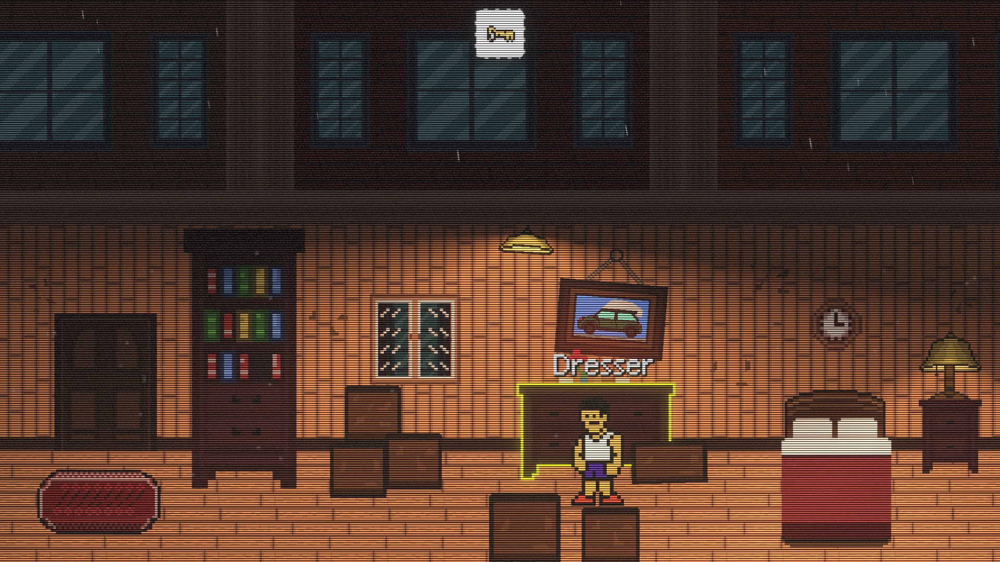
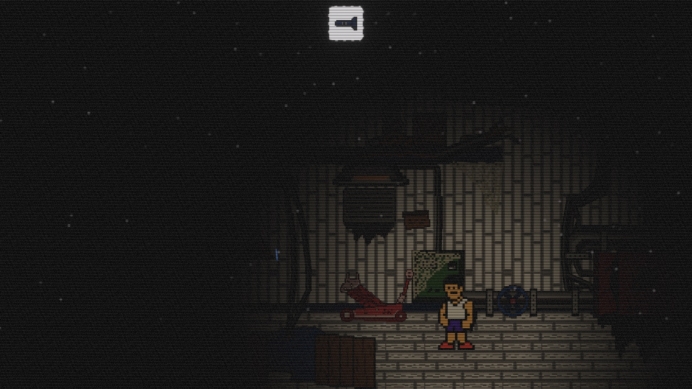

  

  # Tenant's Door

  **A short 2D pixel-art puzzle-platformer about a strange apartment and what lies beneath it.**

  
  
  

  **[Download on itch.io](https://porosb.itch.io/tenants-door)**

---

## About

Your new rented apartment seemed like a good deal. Maybe even too good.

Returning home, you start noticing strange things. An ordinary evening turns into a search for hidden passages, solving riddles, and making interesting discoveries..

Explore the rooms, find useful items, solve puzzles, and unravel the mystery of the rented apartment.

## Screenshots

<table>
  <tr>
    <td width="50%"></td>
    <td width="50%"></td>
  </tr>
</table>

## Features

- **2D pixel art** with a shift from warm domestic spaces to cold, unsettling utility rooms.
- **Environmental puzzles** built around keys, items, mechanisms, and locked passages.
- **Exploration** that rewards inspecting rooms and connecting clues.

## Controls

| Action | Keyboard (default) |
| --- | --- |
| Move | Arrow keys |
| Jump | Space |
| Interact | E |

Gamepad is also supported.

## Project Info

- **Engine:** Unity
- **Genre:** 2D puzzle-platformer
- **Platform:** Windows PC

## License

Tenant's Door is shared under a **non-commercial license**. You may use, modify, and share the project's original materials for non-commercial purposes. Commercial use requires prior written permission.

Some third-party assets or packages included in the project may be governed by their own licenses; see their original terms where applicable.

---

It is a small solo-developed indie game made as a personal game development project. Thanks for checking it out! Feedback is always welcome.
